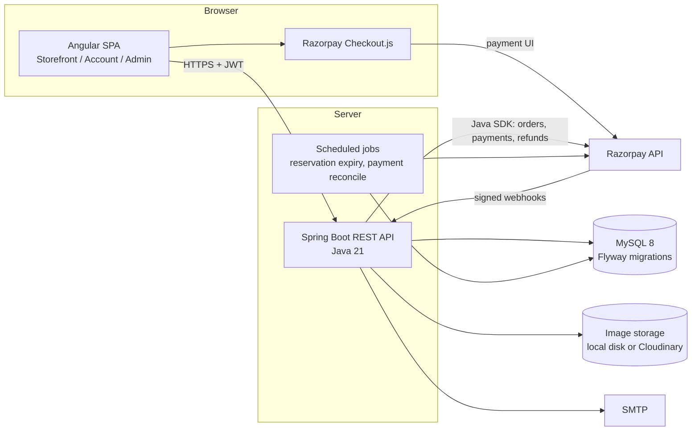
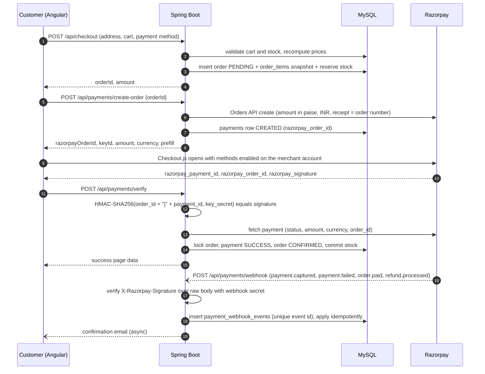

# T-Shirt Shop: System Architecture

Status: **Phase 1 design baseline** (2026-11-02). Later phases may refine details.
Any change to the fixed technology stack requires the owner's approval.

## 1. Overview

A clothing e-commerce platform selling T-Shirts, Shirts, Pants and Customized
T-Shirts. Three user-facing areas share one backend:

| Area | Audience | Angular route prefix | API prefix |
|------|----------|----------------------|------------|
| Storefront | Anonymous + customers | `/` | `/api/products/**`, `/api/categories/**`, `/api/pricing/**` |
| Customer portal | `ROLE_CUSTOMER` | `/account/**` | `/api/account/**`, `/api/cart/**`, `/api/orders/**`, `/api/payments/**` |
| Admin portal | `ROLE_ADMIN` | `/admin/**` | `/api/admin/**` |



## 2. Technology stack (fixed)

| Layer | Choice | Notes |
|-------|--------|-------|
| Frontend | Angular (latest stable at Phase 6), TypeScript, SCSS, Angular Material, RxJS, Reactive Forms, Fabric.js | Standalone components, lazy-loaded feature routes |
| Backend | Java 21, Spring Boot (latest GA compatible with Java 21 at Phase 3), Spring Security, Spring Data JPA / Hibernate, Maven wrapper | Exact versions pinned and recorded in Phase 3 |
| Database | MySQL 8, Flyway | `utf8mb4`, InnoDB, UTC timestamps |
| Auth | JWT access token (short-lived) + rotating refresh token, BCrypt | Stateless API |
| Payments | Razorpay Standard Checkout, Razorpay Java SDK, webhooks | Only online gateway. COD handled internally |
| Images | `StorageService` interface with `LocalStorageService` (default) and `CloudinaryStorageService` | Chosen by `STORAGE_PROVIDER` |
| Docs / tests | springdoc-openapi (Swagger UI), JUnit 5, Mockito, Angular unit tests | Testcontainers-MySQL if Docker is available |

## 3. Key design decisions

1. **Money** is stored as `DECIMAL(12,2)` in INR. It is converted to paise (`long`) only at the Razorpay boundary.
2. **Prices are authoritative on the backend.** The client sends product IDs, variant choices and customization options, never prices. `PricingService` recomputes every line and the order total.
3. **Price snapshots.** Each `order_items` row stores the unit price, the customization charge breakdown (JSON) and the product name at purchase time.
4. **Order status and payment status are separate columns with separate enums.**
   - Order: `PENDING, CONFIRMED, PROCESSING, SHIPPED, OUT_FOR_DELIVERY, DELIVERED, CANCELLED`
   - Payment: `CREATED, PENDING, SUCCESS, FAILED, CANCELLED, REFUNDED`
5. **Inventory is tracked per SKU** (product + size + color) in `inventory` with `quantity_on_hand` and `quantity_reserved`. Available stock is on-hand minus reserved.
6. **Stock reservation with expiry**, described in section 7.
7. **Idempotency.** Webhook events are stored by Razorpay event ID under a unique constraint. Capture handling is idempotent on `razorpay_payment_id`. Order confirmation takes a pessimistic lock on the order row.
8. **Customized T-Shirts** are products in category `CUSTOM_TSHIRT`. Their configuration lives in `custom_designs` (Fabric.js JSON, rendered previews, uploaded asset references) and is linked from cart and order items.
9. **Image storage** never serves files from a user-controlled path. Files get a random UUID name, are validated by magic bytes and size, and are re-encoded server-side where practical.
10. **Flyway owns the schema.** Hibernate runs with `ddl-auto=validate`.

## 4. Backend architecture

Root package `com.shop`:

```
backend/
├── pom.xml
├── mvnw, mvnw.cmd, .mvn/
└── src/
    ├── main/
    │   ├── java/com/shop/
    │   │   ├── TShirtShopApplication.java
    │   │   ├── config/        # CORS, OpenAPI, Jackson, scheduling, storage, Razorpay client beans
    │   │   ├── controller/    # REST controllers (public, account, admin), kept thin
    │   │   ├── service/       # service interfaces
    │   │   ├── service/impl/  # business logic, @Transactional boundaries
    │   │   ├── repository/    # Spring Data JPA repositories
    │   │   ├── entity/        # JPA entities + enums
    │   │   ├── dto/           # request/response records with Bean Validation
    │   │   ├── mapper/        # entity <-> DTO mappers (MapStruct)
    │   │   ├── security/      # SecurityFilterChain, JwtService, JwtAuthFilter, UserDetailsService
    │   │   ├── exception/     # domain exceptions + @RestControllerAdvice (RFC 7807 ProblemDetail)
    │   │   ├── payment/       # RazorpayGateway, signature verification, webhook processor
    │   │   └── util/          # money, slug and file-type sniffing helpers
    │   └── resources/
    │       ├── application.yml          # defaults; all secrets come from env vars
    │       ├── application-dev.yml
    │       ├── application-prod.yml
    │       └── db/migration/            # Flyway V1__init.sql, V2__seed.sql, ...
    └── test/java/com/shop/...           # JUnit 5 + Mockito, @WebMvcTest, @DataJpaTest
```

### 4.1 Main services

| Service | Responsibility |
|---------|----------------|
| `AuthService` | Register, login, refresh, logout, forgot and reset password |
| `UserService`, `AddressService` | Profile, password change, address book with a single default |
| `CategoryService`, `ProductService` | CRUD, search, filter, sort, paginate, images, variants |
| `InventoryService` | Availability checks, reserve, release, commit |
| `CustomDesignService` | Save and load Fabric.js designs, asset uploads, preview images |
| `PricingService` | Authoritative prices for products and customizations, coupons, shipping |
| `CartService` | Server-side cart for logged-in users. A guest cart in local storage is merged on login |
| `CheckoutService` | Validate cart, compute totals, create the `PENDING` order, reserve stock |
| `PaymentService` | Razorpay order creation, verify, status, retry, refunds |
| `WebhookService` | Verify signature on the raw body, de-duplicate, dispatch events |
| `OrderService` | History, details, tracking, cancellation, status transitions, PDF invoices |
| `NotificationService` | Async emails for order confirmation, status changes and password reset |
| `AdminDashboardService` | Revenue, counts, payment stats, best sellers |

### 4.2 Security

- Stateless `SecurityFilterChain`. CSRF is disabled for the JWT API. CORS is restricted to `APP_CORS_ALLOWED_ORIGINS`.
- Public endpoints: `GET /api/products/**`, `GET /api/categories/**`, `/api/auth/**`, `POST /api/pricing/**/estimate`, `POST /api/payments/webhook`, and Swagger outside prod.
- `/api/admin/**` requires `ROLE_ADMIN`. Ownership checks make sure a customer can only read their own orders, designs and addresses.
- Passwords use BCrypt (strength 12). Reset tokens are random, stored hashed, single-use and expire after 30 minutes.
- Refresh tokens are stored hashed and rotated on each use.
- Login attempts are rate limited, with temporary lockout after repeated failures.
- Secrets come only from environment variables. The Razorpay key secret never leaves the backend.

## 5. Frontend architecture

```
frontend/src/app/
├── core/                 # singleton services, interceptors (auth, error, loading), guards, models
├── shared/               # product-card, price-tag, rating, loader, pagination, dialogs
├── layout/               # storefront shell (navbar, footer), account shell, admin shell
├── features/
│   ├── home/
│   ├── auth/             # login, register, forgot/reset password
│   ├── products/         # listing + category pages, filters, sorting, pagination
│   ├── product-details/
│   ├── custom-tshirt-designer/   # Fabric.js canvas, toolbars, live price panel
│   ├── cart/
│   ├── checkout/
│   ├── payments/         # Razorpay launcher, success, failure, retry
│   ├── orders/           # history, details, tracking, invoice
│   ├── customer-profile/ # dashboard, profile, addresses, wishlist
│   ├── static-pages/     # about, contact, privacy, terms, returns
│   ├── admin-dashboard/
│   ├── admin-products/
│   ├── admin-orders/
│   ├── admin-payments/
│   ├── admin-customers/
│   └── admin-customization/
├── app.routes.ts         # lazy loadChildren / loadComponent per feature
└── app.config.ts
```

- **Guards:** `authGuard` for logged-in users, `adminGuard` for the admin role, `guestGuard` to keep logged-in users off login and register.
- **Interceptors:** attach the access token, refresh once on 401 then log out, map API `ProblemDetail` errors to snackbars, drive a global loading indicator.
- **State:** services with RxJS and Angular signals for auth user, cart count and designer state. No extra state library unless needed.
- **No fake data:** every page calls the real API. Sample products come from a Flyway seed migration.
- **Design system:** premium black and white theme through an Angular Material custom theme and SCSS tokens. Serif display headings, clean sans body text, mobile-first breakpoints.

## 6. Payment flow (Razorpay)



Rules:

- `verify` and the webhook both call one idempotent `PaymentService.markCaptured(...)`. Whichever arrives first confirms the order and the second is a no-op.
- The amount and currency reported by Razorpay must equal the stored order total. A mismatch flags the payment for manual review and does not confirm the order.
- A frontend "success" is never trusted without the signature check plus a gateway fetch.
- `POST /api/payments/retry/{orderId}` creates a fresh Razorpay order for an unpaid order. It re-reserves stock first if the earlier reservation expired.
- Auto-capture should be enabled on the Razorpay account. If a payment is only `authorized`, the backend captures it through the SDK.
- COD orders skip Razorpay. They become `CONFIRMED` with payment status `PENDING`, and payment becomes `SUCCESS` when the admin marks cash collected.

Payment APIs: `POST /api/payments/create-order`, `POST /api/payments/verify`,
`GET /api/payments/status/{orderId}`, `POST /api/payments/webhook`,
`POST /api/payments/retry/{orderId}`, plus `POST /api/admin/payments/{id}/refund`.

## 7. Stock reservation and expiry strategy

1. When the pending order is created, `InventoryService.reserve` locks each SKU row with `SELECT ... FOR UPDATE`, increments `quantity_reserved`, and writes `inventory_reservations` rows with `expires_at = now + STOCK_RESERVATION_MINUTES` (default 15).
2. On verified payment or COD placement, reservations become `COMMITTED`. Both `quantity_on_hand` and `quantity_reserved` are decremented.
3. A scheduled job runs every minute. It releases `ACTIVE` reservations past `expires_at` and sets the payment to `CANCELLED`. The order stays `PENDING` and retryable for 24 hours, then becomes `CANCELLED`.
4. **Late payment** captured after expiry: the backend tries to re-reserve. If stock is available it confirms normally. Otherwise it issues an automatic full refund through the Razorpay Refunds API, sets payment `REFUNDED` and order `CANCELLED`, and emails the customer.
5. A reconciliation job polls Razorpay for payments stuck in `CREATED` or `PENDING` beyond the window, to cover lost webhooks.

## 8. Custom T-Shirt designer

- One Fabric.js canvas per side (front, back) over a mockup image for the chosen T-Shirt type and color. Print placements (front, back, left chest, full front, full back) define clip regions.
- Tools: upload PNG/JPG/JPEG, drag, resize, rotate, delete, layer order, add text with font family, size and color.
- Saving sends Fabric JSON per side, rendered PNG previews per side, uploaded asset IDs, type, color, size, placements and text entries.
- The backend validates uploads by magic bytes, max size (default 5 MB), max pixel dimensions and successful decoding. Assets and previews are stored through `StorageService`.
- The price panel calls `POST /api/pricing/customization/estimate`, debounced, on every option change. Cart and checkout always recompute server-side.
- Admin can view previews and download the original assets or a ZIP of the full design.

## 9. Pricing engine

`customization_charges` holds rows of `(charge_type, code, amount, active)`. Initial values:

| charge_type | code | amount (INR) |
|-------------|------|--------------|
| PRINT_PLACEMENT | FRONT | 50 |
| PRINT_PLACEMENT | BACK | 50 |
| PRINT_PLACEMENT | LEFT_CHEST | 30 |
| PRINT_PLACEMENT | FULL_FRONT | 90 |
| PRINT_PLACEMENT | FULL_BACK | 90 |
| TEXT | CUSTOM_TEXT | 30 |
| DESIGN | PREMIUM_DESIGN | 100 |
| TSHIRT_TYPE | OVERSIZED | 80 |
| TSHIRT_TYPE | POLO | 60 |
| SIZE | XXL | 40 |
| COLOR | any color | 0 |

Final price = base + type + size + color + placements + text + premium design, minus coupon discount, plus shipping.
The example from the brief (299 + 50 + 50 + 30) gives 429.
Shipping is free above a configurable threshold and a flat charge otherwise. Both live in the admin-editable `app_settings` table.

## 10. Environments and deployment

Details come in Phase 19.

- `dev` profile: local MySQL, Razorpay test keys, local image storage, Swagger enabled.
- `prod` profile: secrets from the environment, Swagger disabled, HTTPS terminated at Nginx, Angular served as static files by Nginx, Spring Boot as a systemd service or container, daily `mysqldump` backups, structured logs.
