# T-Shirt Shop: Database Design

Status: **Implemented in Phase 2** as Flyway migrations and verified on MySQL 8.4.

| File | Contents | Environments |
|------|----------|--------------|
| `backend/src/main/resources/db/migration/V1__create_schema.sql` | All 31 tables, keys, indexes, CHECK constraints | All |
| `backend/src/main/resources/db/migration/V2__seed_reference_data.sql` | Roles, categories, sizes, colours, T-Shirt types, print placements, fonts, charges, blank custom T-Shirts, settings | All |
| `backend/src/main/resources/db/migration/V3__storefront_engagement.sql` | `coupons.is_public`, new `contact_messages` table (32 tables in total) | All |
| `backend/src/main/resources/db/dev-data/V900__dev_sample_catalog.sql` | 13 sample products, 319 SKUs with stock, images, sample coupons | Dev only |
| `backend/src/main/resources/db/dev-data/V901__dev_sample_reviews.sql` | Five disabled sample reviewers, approved and pending reviews, public sample coupons | Dev only |
| `database/setup/01-create-database.sql` | Database and application user creation | Run once per server |
| `database/verify-migrations.sh` | Applies all migrations to a scratch DB and runs 37 constraint checks | Dev / CI |

The exact DDL in `V1__create_schema.sql` is the source of truth. This document is the readable overview.

Conventions:

- MySQL 8, InnoDB, `utf8mb4` / `utf8mb4_0900_ai_ci`.
- Primary keys: `BIGINT UNSIGNED AUTO_INCREMENT` named `id`.
- Every table has `created_at` and `updated_at` (`DATETIME(6)`, UTC). Mutable aggregates also carry a `version` column for optimistic locking.
- Money: `DECIMAL(12,2)` in INR.
- Enums are stored as `VARCHAR` (not MySQL `ENUM`) so new values need no table rebuild.
- Customer-facing identifiers (order number, design code) are separate from internal IDs.

## 1. Table list

The brief's required tables are all present. Extra supporting tables are marked *(added)*.

| Table | Purpose | Key constraints |
|-------|---------|-----------------|
| `users` | Customers and admins | UK `email`, UK `phone` (nullable), `enabled`, `locked_until` |
| `roles` | `ROLE_CUSTOMER`, `ROLE_ADMIN` | UK `name` |
| `user_roles` | Many-to-many | PK (`user_id`, `role_id`) |
| `refresh_tokens` *(added)* | Hashed rotating refresh tokens | UK `token_hash`, IDX `user_id` |
| `password_reset_tokens` *(added)* | Hashed single-use reset tokens | UK `token_hash`, `expires_at`, `used_at` |
| `addresses` | Customer address book | IDX `user_id`, one default per user enforced in service |
| `categories` | T-Shirts, Shirts, Pants, Customized T-Shirts | UK `slug`, self FK `parent_id` |
| `products` | Catalog items | UK `slug`, FK `category_id`, IDX (`category_id`, `status`), FULLTEXT (`name`, `description`) |
| `product_images` | Ordered gallery | FK `product_id`, `sort_order`, `is_primary` |
| `product_sizes` | Size master (S to XXL, waist sizes for pants) | UK `code` |
| `product_colors` | Color master with hex value | UK `code` |
| `inventory` | Stock per SKU = product + size + color | UK (`product_id`, `size_id`, `color_id`), UK `sku`, `quantity_on_hand`, `quantity_reserved` |
| `inventory_reservations` *(added)* | Time-boxed holds for pending orders | FK `inventory_id`, FK `order_id`, `status`, IDX (`status`, `expires_at`) |
| `customization_options` | T-Shirt types, print placements, fonts, designer colors | UK (`option_type`, `code`) |
| `customization_charges` | Admin-editable price per option | UK (`charge_type`, `code`) |
| `custom_designs` | Saved designer state | UK `design_code`, FK `user_id`, JSON `canvas_front`, `canvas_back`, preview paths |
| `design_assets` *(added)* | Uploaded images used in a design | FK `custom_design_id`, `storage_key`, `mime_type`, `size_bytes`, `sha256` |
| `carts` | One active cart per user | UK `user_id` |
| `cart_items` | Lines in a cart | FK `cart_id`, FK `inventory_id`, FK `custom_design_id` (nullable) |
| `coupons` | Discount codes | UK `code`, type PERCENT/FLAT, min order, max discount, validity window, usage limits |
| `coupon_redemptions` *(added)* | Which user used which coupon on which order, for per-user limits | UK `order_id`, IDX (`coupon_id`, `user_id`) |
| `orders` | Order header | UK `order_number`, FK `user_id`, `order_status`, `payment_status`, `payment_method`, totals, shipping address snapshot |
| `order_items` | Price snapshot per line | FK `order_id`, product name, size, color, unit price, customization breakdown JSON, FK `custom_design_id` |
| `order_status_history` | Audit trail of order status changes | FK `order_id`, from/to status, `changed_by`, note |
| `payments` | One row per payment attempt (Razorpay order) or COD | UK `razorpay_order_id`, UK `razorpay_payment_id`, FK `order_id`, `status`, `method`, amount, currency |
| `payment_transactions` | Gateway events on a payment: authorize, capture, fail, refund | FK `payment_id`, `type`, `gateway_reference`, raw response JSON |
| `payment_webhook_events` | Raw webhook log for idempotency | UK `event_id`, `event_type`, `payload` JSON, `processed_at`, `processing_error` |
| `reviews` | Product ratings | UK (`user_id`, `product_id`), rating 1 to 5, `approved` |
| `wishlists` | Saved products | UK (`user_id`, `product_id`) |
| `newsletter_subscribers` *(added)* | Footer newsletter form | UK `email` |
| `contact_messages` *(added, V3)* | Contact Us submissions | `status` NEW/READ/REPLIED/CLOSED, optional FK `user_id` |
| `app_settings` *(added)* | Shipping charge, free shipping threshold, reservation minutes | UK `setting_key` |

## 2. ER diagram

```mermaid
erDiagram
  users ||--o{ user_roles : has
  roles ||--o{ user_roles : grants
  users ||--o{ refresh_tokens : owns
  users ||--o{ password_reset_tokens : requests
  users ||--o{ addresses : saves
  users ||--o| carts : has
  users ||--o{ orders : places
  users ||--o{ custom_designs : creates
  users ||--o{ reviews : writes
  users ||--o{ wishlists : keeps

  categories ||--o{ categories : parent_of
  categories ||--o{ products : contains
  products ||--o{ product_images : shows
  products ||--o{ inventory : stocked_as
  product_sizes ||--o{ inventory : sized
  product_colors ||--o{ inventory : colored
  products ||--o{ reviews : receives
  products ||--o{ wishlists : saved_in

  inventory ||--o{ inventory_reservations : held_by
  orders ||--o{ inventory_reservations : reserves

  custom_designs ||--o{ design_assets : uses
  customization_options ||--o{ customization_charges : priced_by

  carts ||--o{ cart_items : contains
  inventory ||--o{ cart_items : selected
  custom_designs ||--o{ cart_items : customizes

  coupons ||--o{ orders : applied_to
  coupons ||--o{ coupon_redemptions : redeemed
  orders ||--o| coupon_redemptions : uses
  users ||--o{ coupon_redemptions : redeems
  orders ||--o{ order_items : contains
  inventory ||--o{ order_items : sold
  custom_designs ||--o{ order_items : printed_on
  orders ||--o{ order_status_history : tracks
  orders ||--o{ payments : paid_by
  payments ||--o{ payment_transactions : logs
  payments ||--o{ payment_webhook_events : confirmed_by

  users {
    bigint id PK
    varchar email UK
    varchar phone UK
    varchar password_hash
    varchar full_name
    boolean enabled
    datetime locked_until
  }
  roles {
    bigint id PK
    varchar name UK
  }
  user_roles {
    bigint user_id PK, FK
    bigint role_id PK, FK
  }
  refresh_tokens {
    bigint id PK
    bigint user_id FK
    varchar token_hash UK
    datetime expires_at
    datetime revoked_at
  }
  password_reset_tokens {
    bigint id PK
    bigint user_id FK
    varchar token_hash UK
    datetime expires_at
    datetime used_at
  }
  addresses {
    bigint id PK
    bigint user_id FK
    varchar full_name
    varchar phone
    varchar line1
    varchar line2
    varchar landmark
    varchar city
    varchar state
    char pincode
    boolean is_default
  }
  categories {
    bigint id PK
    bigint parent_id FK
    varchar name
    varchar slug UK
    boolean active
  }
  products {
    bigint id PK
    bigint category_id FK
    varchar name
    varchar slug UK
    text description
    decimal base_price
    decimal discount_price
    varchar status
    boolean featured
    boolean is_customizable
  }
  product_images {
    bigint id PK
    bigint product_id FK
    varchar storage_key
    int sort_order
    boolean is_primary
  }
  product_sizes {
    bigint id PK
    varchar code UK
    int sort_order
  }
  product_colors {
    bigint id PK
    varchar code UK
    varchar name
    char hex
  }
  inventory {
    bigint id PK
    bigint product_id FK
    bigint size_id FK
    bigint color_id FK
    varchar sku UK
    int quantity_on_hand
    int quantity_reserved
    int low_stock_threshold
  }
  inventory_reservations {
    bigint id PK
    bigint inventory_id FK
    bigint order_id FK
    int quantity
    varchar status
    datetime expires_at
  }
  customization_options {
    bigint id PK
    varchar option_type
    varchar code
    varchar label
    boolean active
  }
  customization_charges {
    bigint id PK
    bigint option_id FK
    varchar charge_type
    varchar code
    decimal amount
    boolean active
  }
  custom_designs {
    bigint id PK
    varchar design_code UK
    bigint user_id FK
    bigint base_product_id FK
    varchar tshirt_type
    varchar color_code
    varchar size_code
    json placements
    json canvas_front
    json canvas_back
    json text_items
    boolean premium_design
    varchar preview_front_key
    varchar preview_back_key
  }
  design_assets {
    bigint id PK
    bigint custom_design_id FK
    varchar storage_key
    varchar original_filename
    varchar mime_type
    bigint size_bytes
    char sha256
  }
  carts {
    bigint id PK
    bigint user_id FK, UK
  }
  cart_items {
    bigint id PK
    bigint cart_id FK
    bigint inventory_id FK
    bigint custom_design_id FK
    int quantity
  }
  coupons {
    bigint id PK
    varchar code UK
    varchar discount_type
    decimal discount_value
    decimal min_order_amount
    decimal max_discount
    datetime valid_from
    datetime valid_to
    int usage_limit
    int used_count
    boolean active
  }
  orders {
    bigint id PK
    varchar order_number UK
    bigint user_id FK
    bigint coupon_id FK
    varchar order_status
    varchar payment_status
    varchar payment_method
    decimal subtotal
    decimal customization_total
    decimal shipping_charge
    decimal discount_total
    decimal grand_total
    char currency
    json shipping_address
    varchar contact_email
    varchar contact_phone
    datetime reservation_expires_at
    datetime placed_at
  }
  order_items {
    bigint id PK
    bigint order_id FK
    bigint inventory_id FK
    bigint custom_design_id FK
    varchar product_name
    varchar size_code
    varchar color_code
    int quantity
    decimal unit_base_price
    decimal unit_customization_charge
    decimal line_total
    json price_breakdown
  }
  order_status_history {
    bigint id PK
    bigint order_id FK
    varchar from_status
    varchar to_status
    bigint changed_by FK
    varchar note
  }
  payments {
    bigint id PK
    bigint order_id FK
    varchar provider
    varchar razorpay_order_id UK
    varchar razorpay_payment_id UK
    varchar status
    varchar method
    decimal amount
    char currency
    varchar failure_reason
    decimal refunded_amount
  }
  payment_transactions {
    bigint id PK
    bigint payment_id FK
    varchar type
    varchar gateway_reference
    decimal amount
    varchar status
    json raw_response
  }
  payment_webhook_events {
    bigint id PK
    varchar event_id UK
    varchar event_type
    bigint payment_id FK
    json payload
    datetime received_at
    datetime processed_at
    varchar processing_error
  }
  reviews {
    bigint id PK
    bigint user_id FK
    bigint product_id FK
    tinyint rating
    text comment
    boolean approved
  }
  wishlists {
    bigint id PK
    bigint user_id FK
    bigint product_id FK
  }
```



## 3. Integrity rules

Enforced by the database (CHECK and UNIQUE constraints, all covered by `verify-migrations.sh`):

- Stock can never go negative, and reserved stock can never exceed stock on hand.
- A discount price can never exceed the base price.
- `orders.grand_total = subtotal + customization_total + shipping_charge - discount_total`.
- `order_items.line_total = (unit_base_price + unit_customization_charge) * quantity`.
- Order status, payment status, payment method and reservation status only accept their defined values.
- A Razorpay order ID and a Razorpay payment ID can each belong to only one payment row. COD rows leave both empty.
- A refund can never exceed the paid amount.
- A webhook event ID can be stored only once.
- Design uploads only record `image/png` or `image/jpeg`. Pincodes must be six digits not starting with 0. Ratings are 1 to 5.

Enforced in application code:

- One default address per user: set within a transaction that clears the previous default.
- Stock changes happen under `SELECT ... FOR UPDATE` on the inventory rows.
- `orders.subtotal` and `customization_total` equal the sums over their items. This is asserted in `CheckoutService` and in tests.
- Mutually exclusive print placements, for example FRONT with FULL_FRONT, are rejected using the `excludes` list in each placement's metadata.
- A `payments` row reaches `SUCCESS` only after signature verification plus a gateway fetch, or a verified webhook.
- `payment_webhook_events.event_id` is unique, so a duplicate delivery hits the constraint and is skipped.

## 4. Seed data

Reference data (all environments, `V2`):

- Roles `ROLE_CUSTOMER` and `ROLE_ADMIN`. No user rows: the first admin is created at start-up from `ADMIN_EMAIL` and `ADMIN_PASSWORD`.
- Categories T-Shirts, Shirts, Pants and Customized T-Shirts.
- Sizes S, M, L, XL, XXL and waist sizes W28 to W38. Fourteen colours with hex values.
- T-Shirt types Round Neck, V-Neck, Polo and Oversized. Each has a blank base product priced at INR 299 with every size and eight designer colours, at zero stock.
- Print placements Front, Back, Left Chest, Full Front and Full Back, with print-area boxes and exclusion rules. Eight Google Fonts for text.
- Charges: Front 50, Back 50, Left Chest 30, Full Front 90, Full Back 90, Custom Text 30, Premium Design 100, Oversized 80, Polo 60, XXL 40.
- Settings: shipping 49 below a free-shipping threshold of 999, 15-minute stock hold, 24-hour unpaid cancel, COD enabled up to 5000, 5 MB design uploads.

Development data (dev profile only, `V900`):

- 13 sample products: 5 T-Shirts, 4 Shirts and 4 Pants, with discounts, featured and new-arrival flags.
- 319 SKUs with stock, including 50 units of every blank custom T-Shirt variant.
- Image paths under `/assets/products/` and `/assets/mockups/`, supplied by the frontend in Phase 6.
- Coupons `WELCOME10` and `FLAT100`.

## 5. Re-running the verification

```bash
MYSQL_PWD=<root password> ./database/verify-migrations.sh /path/to/mysql root
```

It drops and recreates the scratch database `tshirt_validate`, applies every migration, runs the checks, and drops the scratch database again.
